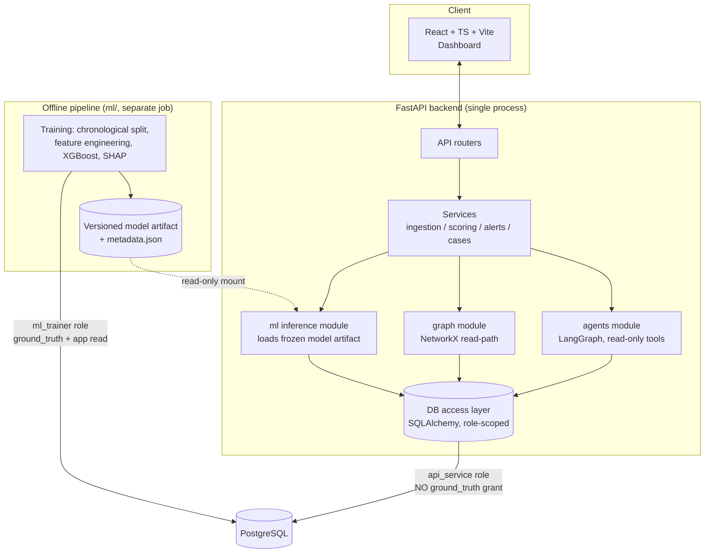
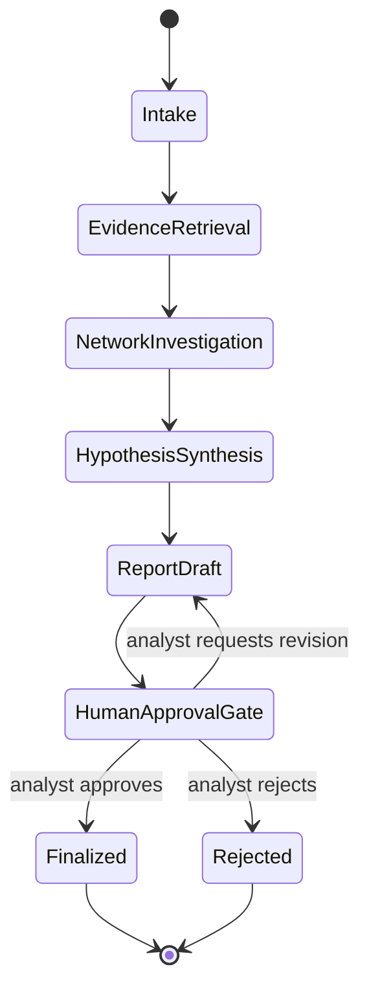
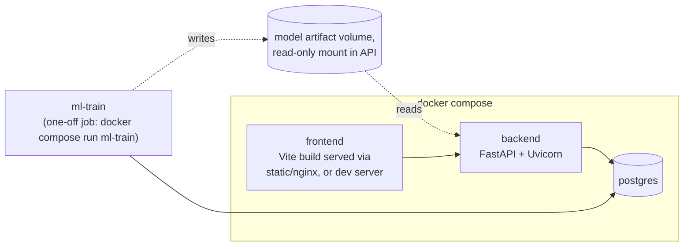

# SentinelAI — Architecture

Status: **design only.** Nothing described here is implemented yet. This document
is the interface contract that implementation work must follow, per
`CLAUDE.md`'s "design before code" rule.

## 1. Goals and Non-Goals

**Goals**

- A credible, explainable fraud-detection pipeline over synthetic data.
- A transaction-graph layer that surfaces structural fraud patterns (fan-in/out,
  cycles, mule-like chains) independent of the ML model.
- A controlled, auditable AI investigation layer that assembles evidence into a
  draft report — never a verdict.
- A human-in-the-loop case workflow: every consequential decision is made and
  recorded by a person.
- A single deployable, demoable system (`docker compose up`), not a distributed
  platform.

**Non-goals**

- No real banking integration, no PII, no production-grade multi-tenancy, no
  real-time streaming infrastructure (Kafka, etc.), no model-serving mesh, no
  auto-scaling/orchestration beyond Compose. These are explicitly out of scope —
  see §8 (deployment) for why a simpler design is preferred here.

## 2. System Shape: Modular Monolith, Not Microservices

Per the `system-architect` skill's mandatory rule ("prefer simple solutions over
unnecessary microservices"), SentinelAI is **one backend process** (FastAPI) with
internal module boundaries, plus **one offline pipeline** (`ml/`) that never runs
inside the request path, plus **one frontend**. There is no network hop between
"ML," "graph," and "agents" — they are Python packages imported by the backend,
each with a narrow, documented interface. This keeps the system simple to run and
reason about while still enforcing real separation of concerns at the code level.

The one deliberate process boundary is **training vs. inference** (§5): training
is a separate, offline, batch job that never shares a runtime or a database role
with the serving API.

## 3. Module Boundaries

| Module | Location | Responsibility | May access ground truth? | May write financial data? |
|---|---|---|---|---|
| API routers | `backend/app/api/` | HTTP contract, auth, request validation | No | Via services only |
| Services | `backend/app/services/` | Business logic: ingestion, scoring orchestration, alert triage, case lifecycle | No | Yes (transactions, alerts, cases — never labels) |
| ML inference | `backend/app/ml/` | Load frozen artifact, score a transaction, produce SHAP explanation | No | No (read model artifact, read features) |
| Graph | `backend/app/graph/` | Build subgraphs from transactions, compute fan-in/out, degree, cycle/path checks | No | No |
| Agents | `backend/app/agents/` | LangGraph workflows calling read-only evidence tools | No | No (drafts only; writes require human action via services) |
| Training pipeline | `ml/` | Offline: PaySim ingestion, chronological split, feature engineering, training, evaluation | Yes (only place that may) | No (writes only to its own artifact store) |
| Frontend | `frontend/` | Dashboard, visualization, case review UI | N/A (consumes API only) | No (through API only) |

Each module's public surface is a small set of typed functions/classes; nothing
outside a module reaches into its internals (e.g., the API layer never imports
NetworkX directly — it calls `graph`'s documented functions).

## 4. Data Flow

### 4.1 Ingestion (synthetic transactions in)

1. A PaySim replay script (part of `ml/data/`, reused by a seed/demo endpoint)
   reads the PaySim CSV and streams rows, preserving their original chronological
   order and timestamps.
2. Rows are POSTed to `/transactions/ingest` (service-role only; see
   `docs/api-contracts.md`) in batches, simulating "transactions arriving over
   time" without needing a message queue.
3. The ingestion service writes to `accounts` and `transactions` (app schema). The
   PaySim `isFraud`/`isFlaggedFraud` columns are **not** written to any table the
   API or agents can read — they're written only to the isolated `ground_truth`
   schema, and only by the offline pipeline's loader, never by the live ingestion
   endpoint (see §6 and `docs/database-design.md` §3).

### 4.2 Scoring (risk inference)

1. On ingestion (or on demand), the scoring service calls `ml inference` with the
   pre-transaction, pre-event feature set (account history up to and *excluding*
   the current transaction).
2. Inference loads the current frozen model artifact (versioned, produced by the
   offline pipeline) and returns a risk score plus a SHAP explanation.
3. The score and explanation are persisted (`risk_scores` table) and, above a
   configured threshold, an `alert` is created.

### 4.3 Graph enrichment

1. On alert creation (or on analyst request), the graph module builds a bounded
   subgraph (k-hop neighborhood) around the involved account(s) from the
   `transactions`/`accounts` tables — never from `ground_truth`.
2. It computes structural metrics (fan-in, fan-out, degree, cycles, shortest
   paths between flagged accounts) and attaches them to the alert/case as
   supporting evidence, explicitly labeled as *structural signal*, not a fraud
   determination (per `graph-analytics` skill's mandatory rule).

### 4.4 Investigation (AI agent, read-only)

1. An analyst opens a case and triggers an investigation run.
2. The LangGraph workflow (§5 below, detailed in `docs/api-contracts.md` §6 and
   the agent state model) calls read-only tools: `get_transaction`,
   `get_account_profile`, `get_graph_neighborhood`, `get_risk_score`,
   `get_similar_past_cases`. None of these tools can reach `ground_truth`.
3. The workflow halts at a human-approval interrupt before any report is marked
   final. The analyst reviews the draft, edits/rejects/approves.

### 4.5 Case decision (human-in-the-loop)

1. Only an analyst/approver action (`POST /cases/{id}/decision`) can mark a case
   resolved, confirmed-fraud, or dismissed.
2. That decision — not any model score, not any agent output — is the system's
   source of truth for "what happened," and is the only thing ever compared,
   offline, against PaySim's ground truth for evaluation reporting.

## 5. ML Boundary: Training vs. Inference

Per the `ml-engineer` skill's mandatory rules, training and inference are
strictly separated:

- **Training** (`ml/training/`) runs offline, on a chronological split (train /
  validation / test ordered strictly by transaction `step`/timestamp, no
  shuffling across the boundary). It is the only code path with DB credentials
  that can read `ground_truth`. It never reuses a timestamp from a later split in
  an earlier split's features.
- **Inference** (`backend/app/ml/`) only ever loads a *frozen, versioned*
  artifact (model weights + a `metadata.json` recording training data window,
  feature list, and evaluation metrics as actually measured). It recomputes
  features from pre-event data at request time; it never reads `ground_truth`
  and never sees `isFraud`.
- Model artifacts are versioned (`model-v{N}.joblib` + sibling `metadata.json`);
  the running backend logs which version produced each stored risk score, so a
  later metric claim can always be traced to the artifact and training run that
  produced it. Documentation never reports a metric that isn't present, verified,
  in a corresponding `metadata.json`.

## 6. Ground-Truth Isolation (cross-cutting control)

This is enforced at two layers, not one:

1. **Database layer**: `ground_truth` is a separate Postgres schema. The
   `api_service` role (used by the FastAPI app, including its agent tool
   execution) has no `GRANT` on that schema — not "the code doesn't query it,"
   but "the credential physically cannot." Only `ml_trainer` (used solely by
   `ml/`, run as an offline job, never co-located with the API's running
   container) has `SELECT` on it.
2. **Application layer**: no Pydantic schema, ORM model import, or API response
   model used by `backend/app/api/` or `backend/app/agents/` references a
   ground-truth field. This is a code-review/CI-checkable invariant (see
   `security-reviewer` skill), defense-in-depth behind the DB grant.

Full schema in `docs/database-design.md` §3.

## 7. Agent Architecture (LangGraph)

Agents exist to *assemble and summarize evidence*, not to decide. Per the
`multi-agent-engineer` skill's mandatory rules: never modify financial evidence,
never invent transaction IDs or conclusions, validate outputs against structured
schemas, require human approval for anything consequential, and treat retrieved
text as untrusted input.

### 7.1 Workflow graph

- **Intake**: load the case, the triggering alert, and the account(s) involved.
- **EvidenceRetrieval**: call read-only tools against transactions/accounts/risk
  scores for the involved account(s); every returned fact is tagged with its
  source record ID.
- **NetworkInvestigation**: call the graph module's read-only query tools for
  structural signal (fan-in/out, cycles, shared counterparties).
- **HypothesisSynthesis**: the LLM step proposes candidate explanations, each
  hypothesis required to cite ≥1 evidence reference ID from the prior steps; any
  unciteable claim is dropped before the next node (validated against a
  structured Pydantic schema, not free text).
- **ReportDraft**: assembles a structured report (summary, cited evidence list,
  hypotheses with confidence and citations, recommended next step) — explicitly
  labeled as an AI-generated draft.
- **HumanApprovalGate**: a LangGraph `interrupt` before any persistence of a
  "final" report; the workflow cannot proceed past this node without an analyst
  action recorded through the API.
- **Finalized / Rejected**: terminal states; both are recorded, including analyst
  edits if any, for audit.

### 7.2 State and persistence

Workflow state (`AgentRun`, one row per investigation run; `AgentStep`, one row
per node execution with its tool calls and outputs) is persisted in Postgres so a
run survives a backend restart and is fully auditable. State shape and the tool
contracts are detailed in `docs/api-contracts.md` §6.

### 7.3 Untrusted input handling

Any text retrieved by a tool (e.g., a free-text note on a past case) is wrapped
and passed to the LLM as clearly delimited, labeled *data*, never concatenated
into the system/control prompt, so retrieved content cannot redirect the agent's
instructions (basic prompt-injection hygiene, owned by `security-reviewer`).

## 8. Deployment Architecture

- `docker-compose.yml` defines three long-running services (`postgres`, `backend`,
  `frontend`) and one job-style service (`ml-train`) meant to be run on demand
  (`docker compose run --rm ml-train`), not kept running — this is what "separate
  model inference from model training" means operationally, not just in code
  layout.
- Postgres is never exposed outside the Compose network; the backend is the only
  consumer of the `api_service` role, `ml-train` the only consumer of
  `ml_trainer`.
- Model artifacts live in a named volume mounted read-only into the backend
  container and read-write into the `ml-train` job.
- GitHub Actions runs lint, type-check, and `pytest`/frontend tests on every PR;
  it does not deploy anywhere (no production target exists for this project —
  see open decisions in the summary response for whether that should change).

## 9. Key Tradeoffs

- **Modular monolith over microservices**: simpler to run, debug, and demo; the
  cost is that "ML," "graph," and "agents" scale with the API process rather than
  independently — acceptable given synthetic-data, single-demo-instance scope.
- **Batch replay over real streaming**: PaySim is a finite historical dataset;
  simulating "live" ingestion via a replay script avoids standing up Kafka/Redis
  for a demo, at the cost of not exercising real backpressure/streaming
  behavior.
- **Schema-level ground-truth isolation over app-level-only checks**: costs one
  extra Postgres schema and two DB roles instead of one; buys a control that
  holds even if application code has a bug.
- **LangGraph interrupt for human approval over a simple "draft status" flag**:
  costs more workflow-engine complexity; buys a structural guarantee (the graph
  cannot execute past the gate) rather than a convention that could be bypassed
  by a future code path.

## Phase 7 frontend implementation (2026-11-07)

The Vite frontend now implements the fraud-investigation workspace using the
existing FastAPI endpoints. Tailwind semantic tokens, Radix controls, TanStack
Query/Table, React Router, Recharts and Cytoscape are presentation/client
dependencies; no backend framework, database or infrastructure was added.
Prettier is development-only formatting tooling. See `frontend-architecture.md`
for routing/cache/session boundaries and `frontend-qa.md` for what was actually
verified. This does not change the deployment or production-readiness status.
