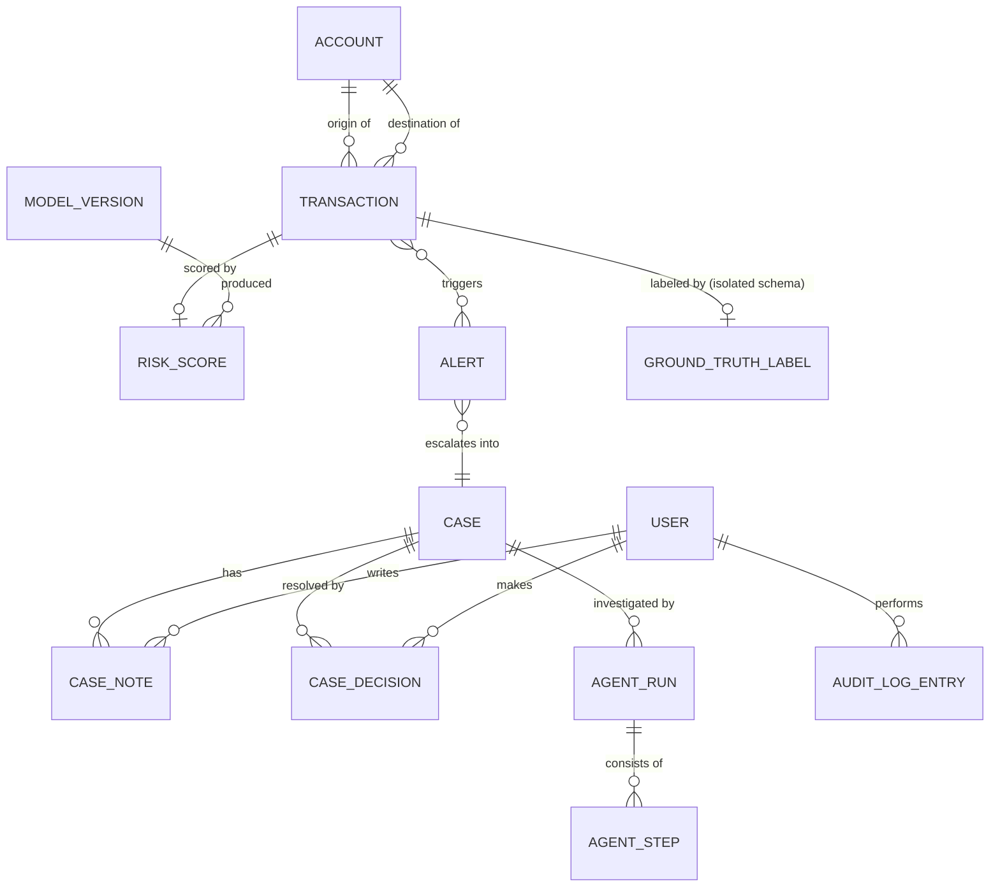

# SentinelAI — Database Design

Status: **§2's `accounts`/`transactions`/`model_versions` sketch and §3 are
implemented** (migrations `0001`–`0003`); **§2's `risk_scores`, `alerts`,
`cases`, `case_alerts`, `case_decisions`, `users`, `audit_log_entries` are
implemented with the field-name and table-set deviations recorded in
`docs/alerts-and-cases.md` §1** (migration `0004`) — read that section
before trusting a field name below for anything Phase 5 touched.
`case_notes` was not implemented (superseded by `case_evidence` — see
`docs/alerts-and-cases.md` §4); `model_versions`/`agent_runs`/
`agent_steps` remain design-only (§5's "Open Schema Questions" still
applies to them; `agent_runs`/`agent_steps` are Phase 6 scope).

Database: PostgreSQL. Two schemas: `app` (everything operational APIs and agents
may read) and `ground_truth` (isolated, training/evaluation only — §3).

## 1. Entity-Relationship Diagram



## 2. `app` schema — operational tables

### `accounts`

| Column | Type | Notes |
|---|---|---|
| `id` | `uuid`, PK | |
| `external_ref` | `text`, unique | PaySim account identifier (`nameOrig`/`nameDest` style) |
| `account_type` | `text` | e.g. `customer`, `merchant` (derived from PaySim naming convention, not inferred fraud signal) |
| `first_seen_at` | `timestamptz` | first transaction timestamp involving this account |
| `created_at` | `timestamptz` | row creation time |

### `transactions`

| Column | Type | Notes |
|---|---|---|
| `id` | `uuid`, PK | |
| `external_ref` | `text`, unique | stable id for replay idempotency |
| `step` | `integer` | PaySim's simulated time step — the chronological ordering key |
| `occurred_at` | `timestamptz` | derived timestamp from `step` |
| `type` | `text` | `CASH_IN`, `CASH_OUT`, `DEBIT`, `PAYMENT`, `TRANSFER` |
| `amount` | `numeric(18,2)` | |
| `origin_account_id` | `uuid`, FK → `accounts.id` | |
| `dest_account_id` | `uuid`, FK → `accounts.id` | |
| `origin_balance_before` | `numeric(18,2)` | pre-transaction balance (PaySim `oldbalanceOrg`) |
| `origin_balance_after` | `numeric(18,2)` | PaySim `newbalanceOrig` |
| `dest_balance_before` | `numeric(18,2)` | PaySim `oldbalanceDest` |
| `dest_balance_after` | `numeric(18,2)` | PaySim `newbalanceDest` |
| `ingested_at` | `timestamptz` | |

Indexes: `(step)`, `(origin_account_id, step)`, `(dest_account_id, step)` — all
chronological-first, since every downstream feature/graph query filters "as of
this step."

**Note:** no `is_fraud` column exists on this table. That is the point of §3.

### `model_versions`

| Column | Type | Notes |
|---|---|---|
| `id` | `uuid`, PK | |
| `version_label` | `text`, unique | e.g. `xgb-v3` |
| `trained_at` | `timestamptz` | |
| `training_window_start_step` / `_end_step` | `integer` | chronological bounds of training data, for traceability |
| `metadata_uri` | `text` | pointer to the artifact's `metadata.json` (feature list + *actually measured* eval metrics) |
| `is_active` | `boolean` | which version inference currently loads |

### `risk_scores`

| Column | Type | Notes |
|---|---|---|
| `id` | `uuid`, PK | |
| `transaction_id` | `uuid`, FK → `transactions.id` | |
| `model_version_id` | `uuid`, FK → `model_versions.id` | |
| `score` | `numeric(6,5)` | model probability output |
| `shap_values` | `jsonb` | feature → contribution, for explanation display |
| `scored_at` | `timestamptz` | |

### `alerts`

| Column | Type | Notes |
|---|---|---|
| `id` | `uuid`, PK | |
| `transaction_id` | `uuid`, FK → `transactions.id` | |
| `risk_score_id` | `uuid`, FK → `risk_scores.id`, nullable | null if alert raised by a graph rule rather than the model |
| `reason` | `text` | `model_threshold`, `graph_structural`, `manual` |
| `status` | `text` | `open`, `triaged`, `escalated`, `dismissed` |
| `created_at` | `timestamptz` | |

### `cases`

| Column | Type | Notes |
|---|---|---|
| `id` | `uuid`, PK | |
| `title` | `text` | |
| `status` | `text` | `open`, `investigating`, `pending_approval`, `resolved_fraud`, `resolved_not_fraud`, `dismissed` |
| `assigned_to_user_id` | `uuid`, FK → `users.id`, nullable | |
| `created_at` / `updated_at` | `timestamptz` | |

### `case_alerts` (join table)

| Column | Type | Notes |
|---|---|---|
| `case_id` | `uuid`, FK → `cases.id` | |
| `alert_id` | `uuid`, FK → `alerts.id` | |

A case may aggregate multiple related alerts (e.g., several alerts on accounts in
the same subgraph).

### `case_notes`

| Column | Type | Notes |
|---|---|---|
| `id` | `uuid`, PK | |
| `case_id` | `uuid`, FK → `cases.id` | |
| `author_user_id` | `uuid`, FK → `users.id` | |
| `body` | `text` | |
| `created_at` | `timestamptz` | |

### `case_decisions` (the human-in-the-loop record)

| Column | Type | Notes |
|---|---|---|
| `id` | `uuid`, PK | |
| `case_id` | `uuid`, FK → `cases.id` | |
| `decided_by_user_id` | `uuid`, FK → `users.id`, **not null** | every decision has an accountable human |
| `decision` | `text` | `confirmed_fraud`, `not_fraud`, `dismissed` |
| `rationale` | `text` | required free-text justification |
| `decided_at` | `timestamptz` | |

### `agent_runs`

| Column | Type | Notes |
|---|---|---|
| `id` | `uuid`, PK | |
| `case_id` | `uuid`, FK → `cases.id` | |
| `started_by_user_id` | `uuid`, FK → `users.id` | |
| `status` | `text` | `running`, `awaiting_approval`, `approved`, `rejected`, `revision_requested`, `failed` |
| `started_at` / `completed_at` | `timestamptz` | |
| `final_report` | `jsonb`, nullable | structured report, only populated once `approved` |

### `agent_steps`

| Column | Type | Notes |
|---|---|---|
| `id` | `uuid`, PK | |
| `agent_run_id` | `uuid`, FK → `agent_runs.id` | |
| `node_name` | `text` | `intake`, `evidence_retrieval`, `network_investigation`, `hypothesis_synthesis`, `report_draft`, `human_approval_gate` |
| `tool_calls` | `jsonb` | tool name, args, and result reference ids — never raw ground truth |
| `output` | `jsonb` | |
| `started_at` / `completed_at` | `timestamptz` | |

### `users`

| Column | Type | Notes |
|---|---|---|
| `id` | `uuid`, PK | |
| `email` | `text`, unique | |
| `password_hash` | `text` | |
| `role` | `text` | `analyst`, `senior_analyst` (may record `case_decisions`), `admin`, (see `api_service` below — not a user role) |
| `created_at` | `timestamptz` | |

### `audit_log_entries`

| Column | Type | Notes |
|---|---|---|
| `id` | `uuid`, PK | |
| `user_id` | `uuid`, FK → `users.id`, nullable | null for system/service actions |
| `action` | `text` | e.g. `login`, `case_decision_recorded`, `agent_run_started`, `agent_run_approved` |
| `entity_type` / `entity_id` | `text` / `uuid` | polymorphic reference |
| `metadata` | `jsonb` | |
| `occurred_at` | `timestamptz` | |

## 3. `ground_truth` schema — isolated

### `ground_truth.transaction_labels`

| Column | Type | Notes |
|---|---|---|
| `transaction_external_ref` | `text`, PK | joins to `app.transactions.external_ref` by value, **not** by FK — no foreign key crosses into this schema, so no ORM relationship can accidentally traverse into it from the `app` side |
| `is_fraud` | `boolean` | PaySim `isFraud` |
| `is_flagged_fraud` | `boolean` | PaySim `isFlaggedFraud` |
| `loaded_at` | `timestamptz` | |

### Access control (enforced in the database, not just in application code)

```sql
-- Roles
CREATE ROLE api_service LOGIN PASSWORD '...';   -- used by the FastAPI backend (incl. agent tools)
CREATE ROLE ml_trainer  LOGIN PASSWORD '...';   -- used only by the offline ml/ training job

-- api_service: full CRUD on app schema, NOTHING on ground_truth
GRANT USAGE ON SCHEMA app TO api_service;
GRANT SELECT, INSERT, UPDATE ON ALL TABLES IN SCHEMA app TO api_service;
REVOKE ALL ON SCHEMA ground_truth FROM api_service;  -- explicit, not just "never granted"

-- ml_trainer: read app (for features) + read ground_truth (for labels); cannot write app
GRANT USAGE ON SCHEMA app TO ml_trainer;
GRANT SELECT ON ALL TABLES IN SCHEMA app TO ml_trainer;
GRANT USAGE ON SCHEMA ground_truth TO ml_trainer;
GRANT SELECT ON ALL TABLES IN SCHEMA ground_truth TO ml_trainer;
```

`api_service` is the only role the running backend container ever authenticates
as — including when executing agent tool calls. It is therefore structurally
impossible (not just "not coded") for an operational API response or an agent
tool to return a ground-truth label. This backs the `backend-engineer`,
`multi-agent-engineer`, and `security-reviewer` skills' mandatory rules on
ground-truth exposure.

## 4. Chronological Integrity Notes

- `transactions.step` (and derived `occurred_at`) is the single source of truth
  for "what happened before what." Every feature-engineering query, every graph
  neighborhood query, and every agent evidence-retrieval tool call that claims to
  reflect "history as of this transaction" must filter strictly by `step <
  current_step` (or `<=` only for same-step same-account aggregates, documented
  per feature).
- The chronological train/validation/test split boundaries (exact step cutoffs)
  are a training-pipeline decision recorded in each `model_versions` row's
  `training_window_start_step`/`_end_step` — not hardcoded in the schema, so the
  schema itself makes no claim about where a given model's split boundary was.
- No table in `app` stores a "future" aggregate (e.g., "total fraud this account
  will ever commit") — every stored aggregate is point-in-time as of its
  `ingested_at`/`scored_at`.

## 5. Open Schema Questions

See the "Unresolved decisions" section of the final architecture summary for:
partitioning `transactions` by `step` range if the demo dataset is large enough
to warrant it, and whether `agent_steps.tool_calls`/`output` payload size needs a
separate blob-style store instead of `jsonb`.
