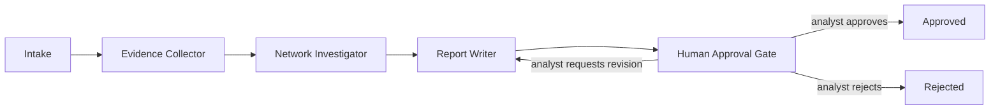

# SentinelAI — Multi-Agent Investigation Architecture (Phase 6)

Status: **implemented and tested** against a real PostgreSQL database
and a real LangGraph (`1.2.20`) execution — 167 backend tests pass (0
failed, 0 skipped) with this phase added. The LLM backing the report
step is a **deterministic mock** in this environment (no
`ANTHROPIC_API_KEY`/`OPENAI_API_KEY` is configured anywhere here) — see
`docs/agent-security.md` §1 and "Real vs. mocked LLM execution" in the
final report for exactly what that means and doesn't mean.

This document extends `docs/architecture.md` §7's original LangGraph
sketch with what was actually built, including the places implementation
deviated from that sketch and why.

## 1. Three agents, one linear workflow

| Node | Agent | Tool access | Produces |
|---|---|---|---|
| `intake` | — (bookkeeping, not an agent) | none (loads the case/alerts/transactions directly) | `account_ids`, `transaction_ids` |
| `evidence_collector` | **Agent 1** | `get_transaction`, `get_account_profile`, `get_risk_score`, `get_shap_explanation`, `get_similar_past_cases` | `evidence: list[EvidenceItem]` |
| `network_investigator` | **Agent 2** | `get_graph_neighborhood`, `get_graph_metrics`, `get_fund_flow` | `network_findings: list[NetworkFinding]` |
| `report_writer` | **Agent 3** | *none* | `report: dict` (summary, hypotheses, uncertainties, recommended next step) |
| `human_approval_gate` | — | none | sets `status="awaiting_approval"`, halts |

Implementation: `app/agents/graph.py` (pure node logic, no persistence —
testable by calling each function directly with a `db` session and a
plain state dict, as `tests/test_agent_security.py` does) and
`app/agents/tools.py` (the read-only tool functions + the explicit
per-agent allow-list, `AGENT_TOOL_PERMISSIONS`). The mapping to
`docs/architecture.md` §7.1's five-node state diagram
(Intake → EvidenceRetrieval → NetworkInvestigation → HypothesisSynthesis
→ ReportDraft → HumanApprovalGate): `evidence_collector` *is*
EvidenceRetrieval, `network_investigator` *is* NetworkInvestigation, and
`report_writer` merges HypothesisSynthesis + ReportDraft into one node
— building the citation-validated hypotheses and drafting the report are
the same computation here (one LLM call, or one deterministic mock call),
not two separate agent turns, which simplified the graph without
changing what's actually verified (every hypothesis still must cite a
real, retrieved evidence reference or be dropped — see §3 below).

## 2. Orchestration: `app/services/investigations.py`

This module owns everything `app/agents/graph.py`'s pure node functions
don't: building and invoking the LangGraph `StateGraph`, retry/timeout
bounding, persisting `AgentRun`/`AgentStep`/`AgentEvidenceRef` as the
run progresses, and the approve/reject/request-revision API actions.
Mirrors this codebase's existing split between `app/graph/` (pure
algorithms) and `app/services/graph_analytics.py` (DB-aware shaping).

### 2.1 Typed state

`app/agents/state.py`'s `InvestigationState` (a `TypedDict`) is the one
shape every node reads and returns a partial update of — LangGraph
merges returned keys into the running state between nodes (Part C
"typed shared investigation state").

### 2.2 Deterministic transitions

The graph is a strict line, not a decision tree: `intake →
evidence_collector → network_investigator → report_writer →
human_approval_gate → END`. There is no conditional branching Part C's
"deterministic workflow transitions" could silently vary by run — the
only thing that varies is the *content* at each step, never *which*
node runs next.

### 2.3 Retries and timeouts — and a real version mismatch found along the way

Each node is registered with LangGraph's official `RetryPolicy`
(`max_attempts=3`) — the supported interface for bounded retries in the
installed LangGraph version. **Node-level `timeout=` turned out not to
be usable here**: discovered while smoke-testing this exact pipeline,
LangGraph 1.2.20 raises `ValueError: Node timeouts are only supported
for async nodes` at `.compile()` time for any sync node, and every node
in this graph is sync (it calls synchronous SQLAlchemy and HTTP code).
Rather than rewrite the backend's DB session usage to async for this one
feature, each node is wrapped in its own `ThreadPoolExecutor.submit().
result(timeout=settings.agent_node_timeout_seconds)` — a wall-clock
bound enforced by the *caller* giving up on waiting, not by LangGraph or
by preemptively killing the node's thread (Python cannot do that safely;
this is documented as a real limitation in §5). The wrapped node always
runs on its own dedicated DB session, never the run-level session the
orchestrator uses for step-recording, specifically so an abandoned
(timed-out) attempt can never race against or corrupt the session the
rest of the run still needs.

### 2.4 Why there's no LangGraph checkpointer

`docs/architecture.md` §7.2 already commits to "workflow state is
persisted in Postgres so a run survives a backend restart" — that
guarantee is provided by `AgentRun`/`AgentStep`/`AgentEvidenceRef`
(Part D), not by LangGraph's own checkpoint store. A
`request-revision` round trip is therefore a *fresh* graph invocation
of just the `report_writer` node, reusing evidence/findings already on
file (read back from `AgentEvidenceRef`) plus the new feedback — never a
live `interrupt()`/resume of a suspended coroutine. This is simpler,
needs no extra Postgres-checkpointer package or elevated DB role for
agents, and satisfies Part C's "do not create unnecessary autonomous
loops" by construction: each revision is one bounded, auditable re-run
(capped at `MAX_REVISION_ROUNDS = 3`), not an open-ended loop.

### 2.5 Background execution, not a task queue

CLAUDE.md's approved stack has no message queue ("deliberately a
modular monolith"). `POST /cases/{id}/investigations` returns
immediately (`202`, `{run_id, status: "running"}`) by submitting the
actual graph execution to a `ThreadPoolExecutor`
(Part F: "should not block ordinary API requests indefinitely") —
nothing beyond Python's standard library and FastAPI's existing
dependencies. The tradeoff, honestly documented rather than silently
gapped: **an in-flight run is not auto-resumed if the backend process
restarts mid-run.** Its `AgentStep` history up to that point is never
lost (every step commits as it completes), but a run frozen at
`status="running"` with no further steps appearing is the visible
symptom of a restart during execution, and nothing in this phase
automatically retries it. A real task queue (Celery, etc.) would close
this gap but isn't in the approved stack; see the Phase 7
recommendation in the final report.

## 3. Evidence validation (no fabrication)

Every hypothesis the report writer emits must cite at least one
`evidence_ref` that was *actually* collected by Agent 1 or Agent 2 in
this run — `app/agents/graph.py::report_writer_node` computes the real
set of collected `source_reference`s and drops any hypothesis citing
one outside it, recording how many were dropped and why in the report's
`uncertainties`. This is checked in code, not left to the model's
honesty, and is covered directly by
`tests/test_agent_security.py::test_report_writer_drops_hypothesis_citing_a_fabricated_evidence_ref`
(a hand-constructed fabricated reference) and
`...test_report_writer_keeps_hypothesis_citing_a_real_evidence_ref`.

See `docs/agent-tools.md` for exactly how each tool resolves evidence
from a real record (never a placeholder) and `docs/agent-security.md`
for the full security posture.

## 4. A real leakage bug found and fixed while building this

`evidence_collector_node`'s `get_account_profile` call originally passed
`as_of_step=max_step + 1` (where `max_step` is the latest investigated
transaction's step) — meaning that transaction's own step counted as
"prior" history for the account it involves, violating this project's
own strict `step <` convention (`docs/database-design.md` §4) by one
off-by-one. Found by actually running the pipeline end-to-end against a
real database during this phase (a single transaction showing "1 prior
transaction" when it should show zero) and fixed to `as_of_step=
max_step`, matching the existing `app/services/history.py` convention
exactly. Documented here rather than silently fixed, per this project's
practice of recording real bugs found and corrected, not just the ones
a test happened to catch first.

## 5. Known limitations

- **Cooperative, not preemptive, per-node timeout** (§2.3) — a node
  that hangs past its timeout is abandoned by the caller, not killed;
  its thread may keep running in the background on its own DB session
  until it finishes naturally.
- **No automatic resume after a mid-run process restart** (§2.5).
- **No conditional branching** — a structural pattern found by Agent 2
  cannot currently change what Agent 3 is asked to investigate further;
  it can only inform what Agent 3 writes about. Adding a
  "request deeper investigation" edge is a reasonable Phase 7 addition.
- **`get_similar_past_cases`'s similarity heuristic is "shares a
  counterparty account"** — deliberately simple, not a learned
  embedding, and labeled as such in every result (`docs/agent-tools.md`).
- Only three agents exist. A fourth role (e.g. a compliance-rules
  checker) would slot in between `network_investigator` and
  `report_writer` without restructuring the rest of the graph.
